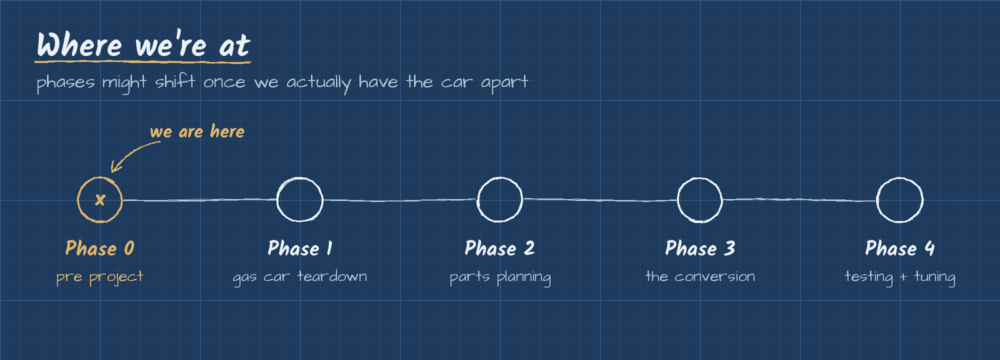

# RC Gas to Electric

We're taking a nitro (gas) RC car and converting it to run electric. The engine comes out, a brushless motor, ESC and LiPo battery go in.

We're four first year engineering students at Columbia Basin College in Pasco, WA, two electrical and two mechanical. This repo is our engineering notebook for the project. We write it as we learn, so if something in here is wrong, it's because we were wrong at the time, and we'll fix it once we figure it out.



## The team

| Name | Major | GitHub |
|---|---|---|
| Moaiad Eljack | Electrical Engineering | [@moaiad-eljack](https://github.com/moaiad-eljack) |
| Miguel | Mechanical Engineering | coming soon |
| Ayzlyn | Mechanical Engineering | coming soon |
| Lily | Electrical Engineering | coming soon |

All four of us work on every part of this together. Nobody owns one piece of the car, so the EE and ME sides end up learning from each other the whole way.

## Phases

| Phase | Status |
|---|---|
| [0. Pre project](phase-0-pre-project/): learn how the electric side works before touching the car | Done |
| 1. Gas car teardown | Next meeting |
| 2. Parts planning | Not started |
| 3. The conversion | Not started |
| 4. Testing and tuning | Not started |

Each phase has its own folder with a README that explains what we did, what we learned, and what it leads into. Folders show up as we get to them.

## How this repo is laid out

```
phase-0-pre-project/   theory notes before we touch the car
  motors.md
  esc.md
  lipo-batteries.md
  wiring.md
  images/              our sketches
images/                repo level images (roadmap)
photos/                real photos of the team and the car
photo-credits.md       where the part photos come from
```

## How we work

- Notes go in after every meeting, not weeks later.
- We don't write ahead. The next meeting gets one line in the notes and that's it.
- If something we wrote turns out wrong, we fix it and say what changed in the commit.
- Part photos we didn't take ourselves come from Wikimedia Commons and get credited right under the photo. Full list in [photo-credits.md](photo-credits.md).

## Safety

LiPo batteries can catch fire if they're overcharged, over drained or damaged. Before anyone charges or plugs anything in, read [lipo-batteries.md](phase-0-pre-project/lipo-batteries.md).

## Credits

Built by Moaiad Eljack, Miguel, Ayzlyn and Lily at Columbia Basin College, Pasco, WA. Part photos are from Wikimedia Commons, full list in [photo-credits.md](photo-credits.md).
