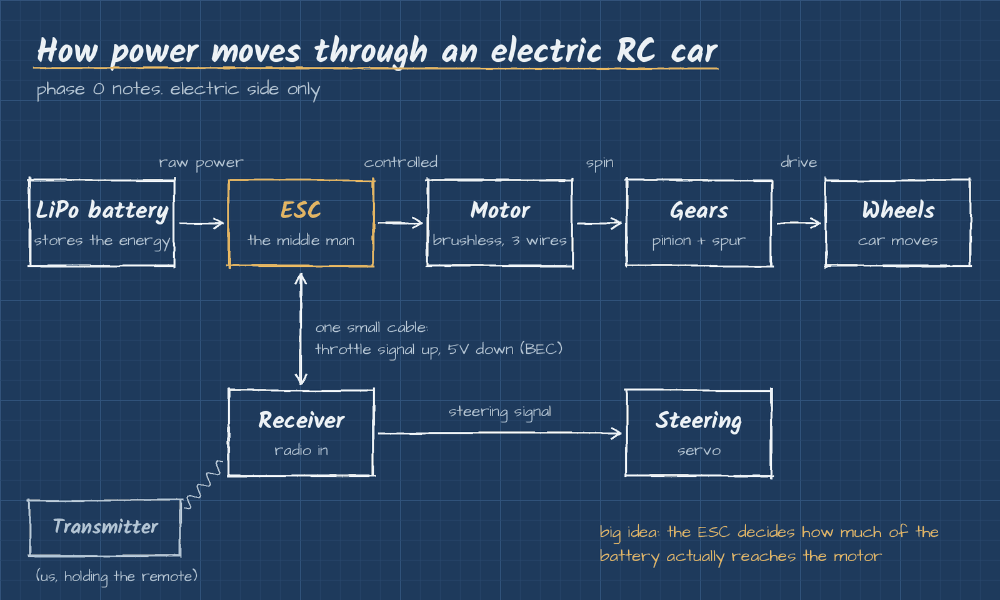

# Phase 0: Pre project

**Status:** done

Before we touch the car, we wanted to understand the electric side for real. If we're pulling a nitro engine out and putting a motor in, we should know what that motor, the ESC and the battery are actually doing, and how they talk to each other.

Meeting 1 was motors. Meeting 2 was ESC basics. After that we went through the wiring and the batteries.

## The big picture

The battery stores the energy, the ESC decides how much of it reaches the motor, and the motor spins the gears that drive the wheels. The receiver takes the signal from our transmitter and tells the ESC what to do. That's the whole electric drivetrain.

## Notes

| Topic | What's in it |
|---|---|
| [Motors](motors.md) | Brushed vs brushless, what kV means, motor sizes |
| [ESC](esc.md) | What the ESC does, BEC, cutoff, calibration |
| [LiPo batteries](lipo-batteries.md) | Cells, voltages, capacity, safety rules |
| [Wiring](wiring.md) | How everything connects and the order to plug it in |

## What we took away

1. **We're going brushless.** More power, runs cooler, and almost nothing wears out. It's what makes sense for a conversion.
2. **The ESC is the middle man.** It controls speed and braking, and its BEC powers the receiver and steering servo too, so a separate receiver battery isn't needed.
3. **Motor and battery get picked together.** kV times voltage sets how fast the motor wants to spin, so a high kV motor on a big battery overheats.
4. **Polarity is not optional.** Red to red, black to black. Backwards kills the ESC on the spot.

## Where this leads

Phase 0 gave us the electric side, which leads us to Phase 1: the gas car itself. Next meeting we're taking a look at the nitro car and figuring out what comes out and what goes in.
