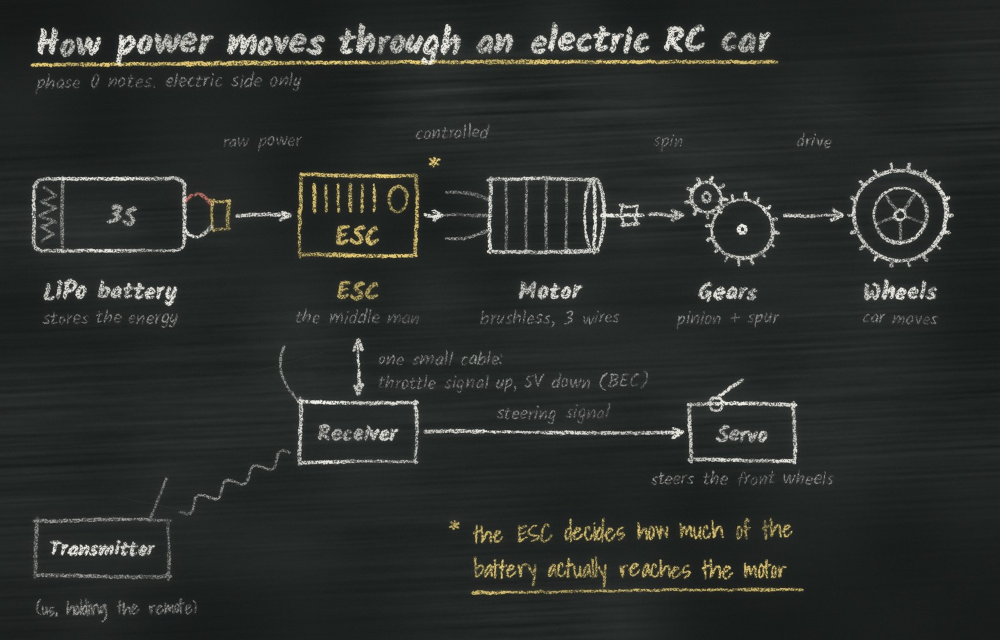

# Phase 0: Pre project

**Status:** done

Before we touch the car, we wanted to understand the electric side for real. If we're pulling a nitro engine out and putting a motor in, we should know what that motor, the ESC and the battery are actually doing, and how they talk to each other.

## How it went

**Meeting 1: motors.** We started with the motor because it's the part that replaces the engine. We kept it basic on purpose: what makes it spin, and what the real difference is between brushed and brushless. Brushless is what we're going with.

**Meeting 2: the ESC.** Once the motor made sense, the next question was what tells it how fast to go. That's the ESC. We went over what it does and why it has to match the motor.

**Wiring.** After the ESC we looked up how everything actually plugs together. We saved a few diagrams we found online, then sketched it out ourselves so we'd understand it and not just copy it.

**Batteries.** Last was the LiPo. Mostly the numbers on the label and the rules that keep it from getting damaged or catching fire.

**Writing it down.** Then we set up this repo and a shared doc, went back through our notes, and fixed the parts we had wrong. Those fixes are at the bottom of [motors.md](motors.md).

## The big picture

The battery stores the energy, the ESC decides how much of it reaches the motor, and the motor spins the gears that drive the wheels. The receiver takes the signal from our transmitter and tells the ESC what to do. That's the whole electric drivetrain.

Here's what those parts look like for real:

*A full electric RC car system: (1) transmitter, (2) receiver, (3) steering servo, (4) battery, (5) ESC, (6) brushless motor. Photo: [Shingo.a](https://commons.wikimedia.org/wiki/File:RC_System_for_car(Brushless).jpg), CC0, via Wikimedia Commons.*

*Same parts packed into a real chassis (a Yokomo drift car). Labels are in French: moteur = motor, variateur = ESC, batterie = battery, récepteur = receiver. Photo: [Espelir](https://commons.wikimedia.org/wiki/File:Chassis_RC_Drift_-_R%C3%A9partition_des_%C3%A9lements.jpg), CC BY-SA 4.0, via Wikimedia Commons.*

## Notes

| Topic | What's in it |
|---|---|
| [Motors](motors.md) | Brushed vs brushless, what kV means, motor sizes |
| [ESC](esc.md) | What the ESC does, BEC, cutoff, calibration |
| [LiPo batteries](lipo-batteries.md) | Cells, voltages, capacity, safety rules |
| [Wiring](wiring.md) | How everything connects and the order to plug it in |

## What we took away

1. **We're going brushless.** More power, runs cooler, and almost nothing wears out. It's what makes sense for a conversion.
2. **The ESC is the middle man.** It controls speed and braking, and its BEC powers the receiver and steering servo too, so a separate receiver battery isn't needed.
3. **Motor and battery get picked together.** kV times voltage sets how fast the motor wants to spin, so a high kV motor on a big battery overheats.
4. **Polarity is not optional.** Red to red, black to black. Backwards kills the ESC on the spot.

## Where this leads

Phase 0 gave us the electric side, which leads us to Phase 1: the gas car itself. Next meeting we're taking a look at the nitro car and figuring out what comes out and what goes in.
