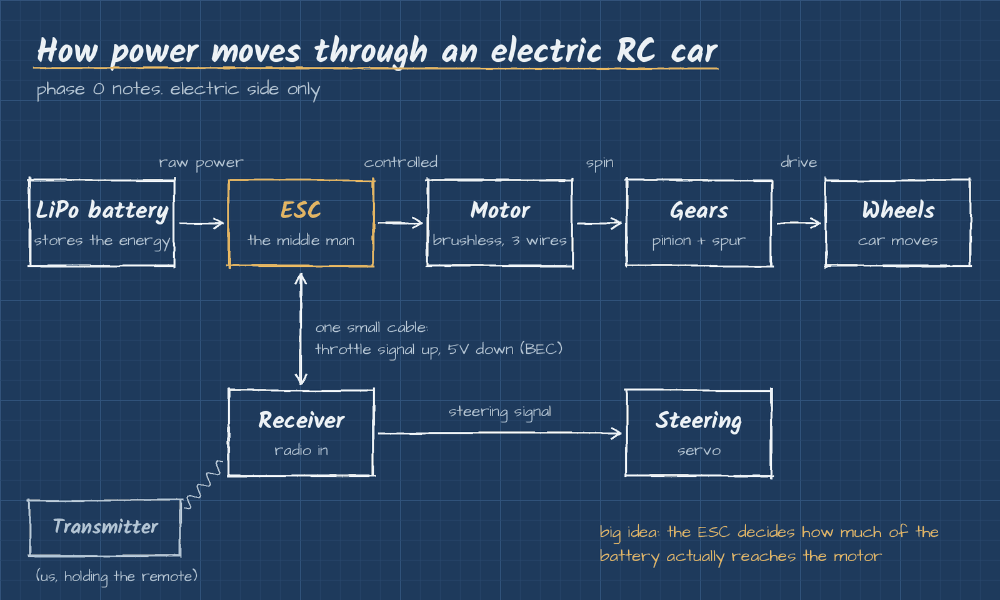

# ESC (Electronic Speed Controller)

The ESC sits between the battery and the motor. Think of it as the throttle and the brakes in one box. It reads the signal from the receiver and decides how much battery power actually reaches the motor.

## What we need to know

- **Match the type.** Brushless motor needs a brushless ESC.
- **Amp rating.** The ESC's amp rating has to be the same or higher than what the motor pulls. Undersized ESC means it overheats or burns out.
- **BEC.** Most ESCs have a BEC (Battery Eliminator Circuit) built in. It steps the battery voltage down to around 5 to 6V and sends it up the small 3 wire lead to power the receiver and steering servo. That's why an electric car doesn't need a separate receiver battery.
- **Low voltage cutoff.** Set it to LiPo. It cuts power before the battery drains low enough to get damaged.
- **Calibration.** Before the first run, the ESC has to learn the transmitter: where neutral is, full throttle and full brake. Every brand does it a little differently, so we follow the manual for whatever ESC we end up with.
- **Placement.** Mount it away from the receiver to cut down on interference.

## How it fits

Next up: [LiPo batteries](lipo-batteries.md)
