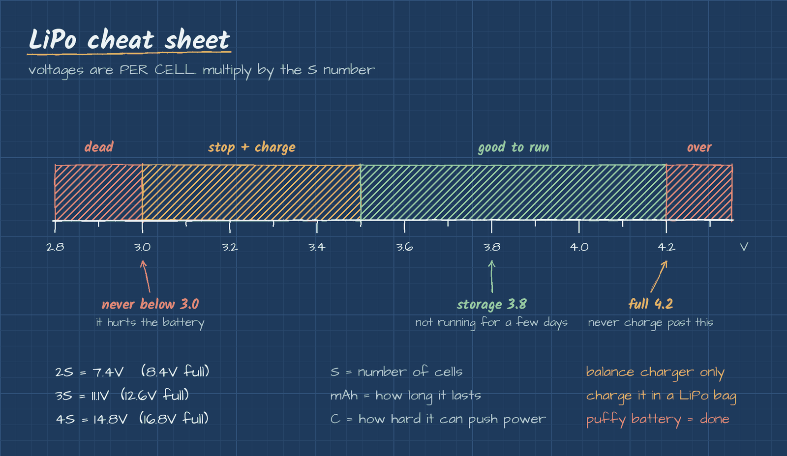

# LiPo batteries

LiPo (lithium polymer) is what most electric RC cars run. Lots of power for the weight, but they need to be treated right or they swell up, die or catch fire.

## Reading the label

*A 3S (11.1V) LiPo pack like the ones used in RC models. Photo: [Achimd](https://commons.wikimedia.org/wiki/File:Lithium_polymer_battery_(11.1_volts).jpg), Public domain, via Wikimedia Commons.*

- **S:** number of cells in series. Each cell is 3.7V nominal and 4.2V when full.
  - 2S = 7.4V (8.4V full)
  - 3S = 11.1V (12.6V full)
  - 4S = 14.8V (16.8V full)
- **mAh:** capacity. Basically how long it runs.
- **C rating:** how fast it can push power out. Higher is better for a fast car.

## Voltages that matter (per cell)

| Voltage | What it means |
|---|---|
| 4.2V | Full. Never charge past this |
| 3.8V | Storage. Leave it here if it's sitting for a few days |
| 3.5V and below | Stop running and charge it |
| 3.0V | Never go below this. It damages the cells |

## Rules

*A common balance charger (Imax B6AC). The small white ports on the side are where the battery's balance plug goes, so every cell charges evenly. Photo: [KundaliniZero](https://commons.wikimedia.org/wiki/File:Charger_Battery.JPG), CC BY-SA 3.0, via Wikimedia Commons.*

- Always charge with a LiPo **balance** charger, and never leave it charging alone.
- Charge and store it in a LiPo safe bag.
- Never run it below 3.0V per cell. The ESC's low voltage cutoff helps with this.
- If a battery puffs up or gets damaged, it's done. Stop using it.

Next up: [Wiring](wiring.md)
