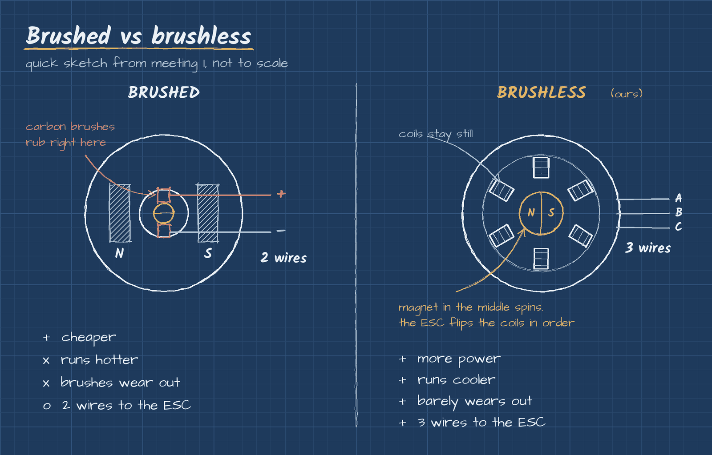

# Motors

The battery sends power to the motor, and the motor spins the gears that drive the wheels. Pretty simple at the top level. The interesting part is how the motor flips its magnetic field to keep spinning, and that's where brushed and brushless split.

## Brushed vs brushless

| | Brushed | Brushless |
|---|---|---|
| How it switches | Carbon brushes rub on a spinning contact (the commutator) and flip the poles mechanically | No brushes. The ESC switches the coils electronically |
| Wires to the ESC | 2 | 3 |
| Heat | Runs hotter (friction from the brushes) | Runs cooler |
| Wear | Brushes wear out over time | Almost nothing to wear out |
| Cost | Cheaper | More expensive |

### What they look like

*A Mabuchi RS-540SH, the classic brushed 540 motor that comes in a lot of 1/10 kits. Two wires. Photo: [Shingo.a](https://commons.wikimedia.org/wiki/File:RS540SH.jpg), CC BY-SA 4.0, via Wikimedia Commons.*

*Inside a small brushed motor: the can with the magnets, the spinning armature, and the brushes that rub on the commutator. Those brushes are what wear out. Photo: [Ilia Krivoruk](https://commons.wikimedia.org/wiki/File:Brushed_dc_motor_assembly.jpg), CC BY-SA 3.0, via Wikimedia Commons.*

*Inside a brushless motor: the copper coils stay still and the ESC switches them on in order. This one is from a small fan motor, but RC motors work the same way. Photo: [Medvedev](https://commons.wikimedia.org/wiki/File:Stator_Winding_of_a_BLDC_Motor.jpg), CC BY-SA 3.0, via Wikimedia Commons.*

**Our pick: brushless.** For a conversion where we want real power out of the car, it's the obvious choice.

## What the motor numbers mean

- **kV:** how many RPM the motor spins per volt, with no load. A 3000kV motor on 11.1V wants to spin around 33,000 RPM. Higher kV means more speed but less torque and more heat. Lower kV means more torque.
- **Size:** 1/10 scale cars usually run a 540 size motor (somewhere around 3000 to 4000kV on 2S or 3S). 1/8 scale cars run a bigger 1/8 motor (around 2000kV on 4S is common).
- **kV and battery go together.** Voltage times kV is how fast the motor tries to spin. Put a high kV motor on a big battery and it overheats. We pick them as a combo, never separately.

## Things we got wrong at first

Our first notes said brushed motors work with "magnets touching the shaft." That's not it. The magnets are fixed to the can, and the brushes are what touch the spinning part. Fixed it here.

Next up: [ESC](esc.md)
