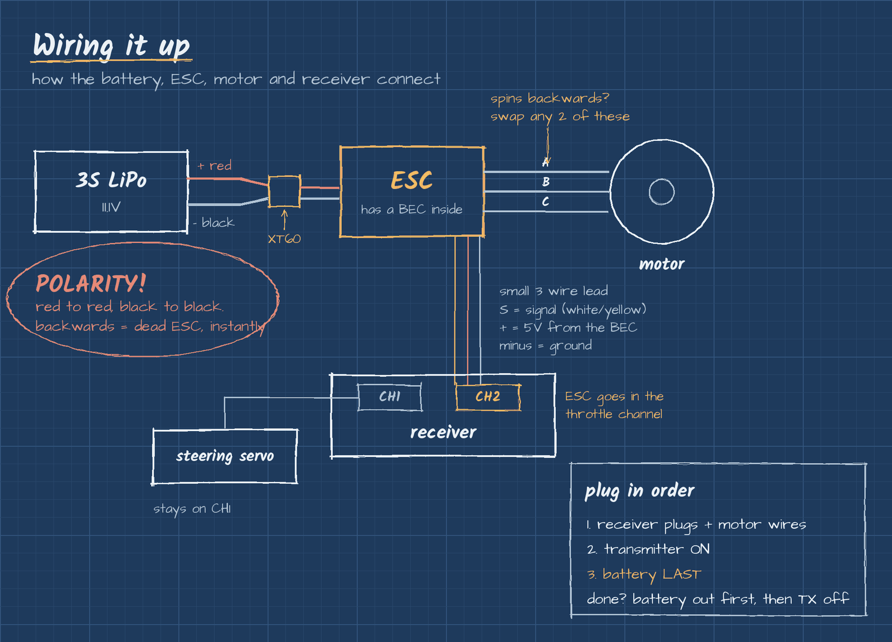

# Wiring

How the battery, ESC, motor and receiver all connect. The ESC is the power hub: the battery feeds it, and it feeds the motor and the receiver.

## Connections

1. **Battery to ESC:** thick red to red (+) and black to black (negative). The plugs have to match (XT60, Deans, EC5 and so on). Getting this backwards kills the ESC instantly.
2. **ESC to motor:** the 3 motor wires. Order doesn't matter at first. If the motor spins the wrong way, swap any 2 of them.
3. **ESC to receiver:** the small 3 wire lead goes in the throttle channel, usually CH2.
   - Red = power (+), black or brown = ground, white, yellow or orange = signal.
   - The signal wire goes on the pin marked S. A plug in backwards can fry the receiver.
4. **Steering servo:** stays in the steering channel, usually CH1.

## Plug in order

1. Receiver plugs and motor wires first
2. Turn on the transmitter
3. Plug in the battery **last**

When done, unplug the battery first, then turn off the transmitter. That way the car never has power without a signal telling it what to do.

## Troubleshooting

| Problem | Check |
|---|---|
| Receiver won't power on | ESC lead fully seated, red on the + pin |
| Motor spins the wrong way | Swap any 2 of the 3 motor wires |
| No signal | Signal wire on the S pin, not flipped |

Back to [Phase 0](README.md)
